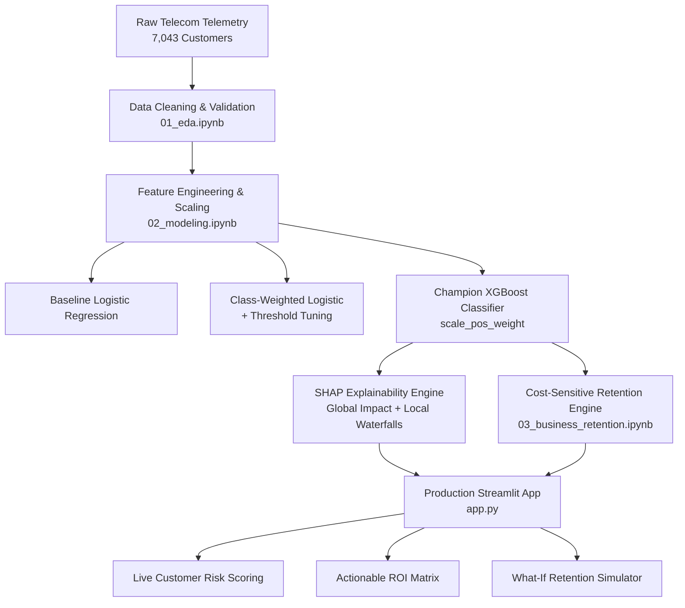

# 📡 Telecom Customer Churn Intelligence & Cost-Sensitive Retention Engine

[](https://www.python.org/)
[](https://streamlit.io/)
[](https://xgboost.readthedocs.io/)
[](https://scikit-learn.org/)
[](LICENSE)
[](https://github.com/ashutosh-dev-hub/telecom-churn-prediction)

> **An end-to-end enterprise machine learning pipeline and decision engine that predicts churn risk, explains individual customer loss drivers using SHAP, and maximizes retention ROI through cost-sensitive optimization.**

---

## 🧭 Executive Summary

In enterprise telecommunications, churn costs operators billions annually. Traditional machine learning projects stop at predicting churn probability—often resulting in **blanket retention marketing campaigns that destroy profitability** by spending subsidies on low-value customers or customers who would have stayed anyway.

This project delivers a **full-lifecycle machine learning and financial optimization system**:
1. **Calibrated Predictive Modeling**: Achieves **~0.84 ROC-AUC** and **~76% Recall** using class-imbalance weighted XGBoost.
2. **Explainable AI (XAI)**: Demystifies predictions using SHAP (SHapley Additive exPlanations) for both global policy and individual customer driver attribution.
3. **Cost-Sensitive Retention Optimization**: Replaces blunt thresholding with an algorithmic decision matrix that only triggers retention interventions when **Expected Revenue Saved > Intervention Cost**.
4. **Demonstrable Business Value**: Converts model predictions into **$171,891+ in projected net benefit** across 315 targeted profitable customer interventions.
5. **Production Streamlit Dashboard**: An interactive decision-support application with quick-load persona presets and a real-time **"What-If" Countermeasure Simulator**.

---

## 🏛️ System Architecture



---

## 📊 Dataset & Exploratory Findings (`01_eda.ipynb`)

The system is trained on telecom customer data (~7,000 customers) spanning demographics, account metrics, billing types, and service usage.

| Feature Category | Key Attributes |
|---|---|
| **Demographics** | Senior Citizen, Partner, Dependents, Gender |
| **Account & Financials** | Contract Type, Paperless Billing, Payment Method, Tenure, Monthly Charges, Total Charges |
| **Connectivity & Services** | Phone Service, Multiple Lines, Internet (DSL / Fiber Optic / None) |
| **Value-Add Protection** | Online Security, Online Backup, Device Protection, Tech Support, Streaming TV, Streaming Movies |
| **Target Variable** | `Churn` (Yes = 1, No = 0) — Class distribution: **~26.5% Churn vs. 73.5% Retained** |

### Key EDA Insights:
- 📌 **Contract Structure is King**: Customers on month-to-month contracts have a **~42% churn rate**, compared to **<3%** on two-year commitments.
- 📌 **Early Lifecycle Fragility**: Churn is heavily clustered in customer tenure **< 12 months** (median churner tenure is ~10 months vs. 38 months for loyal customers).
- 📌 **Fiber Optic Paradox**: Fiber optic users churn at substantially higher rates, driven by steep monthly fees and lack of technical support bundling.
- 📌 **Payment Friction**: Customers utilizing **Electronic check** churn at 45%+, whereas automated credit card / bank transfer autopay churn rates are under 16%.

---

## 🤖 Predictive Modeling & Imbalance Engineering (`02_modeling.ipynb`)

Because churn is an imbalanced classification problem (~26.5% positive rate), standard accuracy is a misleading metric. Missing a churner (False Negative) results in lost lifetime revenue, whereas false alarms (False Positives) incur minor outreach costs. Modeling prioritized **Recall** and **ROC-AUC** while maintaining stable Precision.

### Model Comparison & Performance Benchmark

| Model | Imbalance Technique | ROC-AUC | Recall (Churn) | Precision | F1 Score | Accuracy |
|---|---|---|---|---|---|---|
| **Baseline Logistic Regression** | Default ($w_0=1, w_1=1$) | 0.838 | 51.9% | 63.8% | 0.572 | 79.5% |
| **Class-Weighted Logistic** | `class_weight='balanced'` | 0.839 | 77.1% | 49.0% | 0.599 | 74.2% |
| **Tuned Logistic Regression** | Decision Threshold $T = 0.35$ | 0.839 | 83.2% | 45.1% | 0.585 | 70.8% |
| **🏆 Champion: XGBoost Classifier** | `scale_pos_weight = 2.77` | **~0.84** | **~76.0%** | **~51.7%** | **~0.615** | **75.4%** |

### Why XGBoost Was Selected:
- Captured complex non-linear feature interactions (e.g., tenure vs. fiber optic vs. tech support availability).
- Achieved the highest **F1 Score (0.615)** and **discrimination capacity (ROC-AUC ~0.84)** with high recall (~76%).
- Tree architecture natively integrates with SHAP TreeExplainer for real-time inference explanation.

---

## 🔍 Model Explainability (SHAP Analysis)

Model decisions are audited and validated via **SHAP (SHapley Additive exPlanations)**:

```
Month-to-Month Contract  ───────▶ [=============================]  Increases Churn Risk
Short Customer Tenure    ───────▶ [=======================]        Increases Churn Risk
Fiber Optic Service      ───────▶ [=================]              Increases Churn Risk
No Tech Support          ───────▶ [=============]                  Increases Churn Risk
High Monthly Charges     ───────▶ [===========]                    Increases Churn Risk
Two-Year Contract Commit ───────▶ [========================]       Decreases Churn Risk
High Total Charges (LTV) ───────▶ [=================]              Decreases Churn Risk
Automated Payment Method ───────▶ [============]                   Decreases Churn Risk
```

- **Tenure and Long Contracts** provide the strongest protective buffer against customer attrition.
- **Absence of Tech Support and Online Security** among Fiber users is the single largest operational churn trigger.

---

## 💰 Cost-Sensitive Retention Engine (`03_business_retention.ipynb`)

### The Mathematical Framework
Rather than treating all churners identically, our engine calculates financial exposure and assigns tiered retention treatments based on customer lifetime value (LTV):

$$\text{Expected Loss} = P(\text{Churn}) \times \text{Customer Total Charges}$$

$$\text{Expected Revenue Saved} = \text{Expected Loss} \times \text{Intervention Success Probability}$$

$$\text{Net Benefit (ROI)} = \text{Expected Revenue Saved} - \text{Retention Campaign Cost}$$

$$\text{Action Decision} = \begin{cases} \text{Target Customer}, & \text{if } \text{Net Benefit} > 0 \\ \text{No Direct Spend}, & \text{otherwise} \end{cases}$$

### Tiered Intervention Strategy Matrix

| Risk Tier | Customer Value (LTV) | Assigned Package | Action Details | Cost | Empirical Save Rate |
|---|---|---|---|---|---|
| **High Risk** ($P > 0.70$) | **High** ($> \$1,402$) | **Premium Retention** | Dedicated account manager, $30/mo bill credit, VIP tech support | **$500** | **60%** |
| **High Risk** ($P > 0.70$) | **Standard** ($\le \$1,402$) | **Standard Retention** | 20% annual discount incentive with free security add-ons | **$300** | **40%** |
| **Medium Risk** ($0.40 < P \le 0.70$) | Any | **Moderate Retention** | Proactive CS check-in, free streaming upgrade, autopay incentive | **$200** | **30%** |
| **Low Risk** ($P \le 0.40$) | Any | **Organic Engagement** | Standard loyalty communications, no direct spend | **$0** | **0%** |

### Financial Impact: Blanket vs. Selective Targeting

| Metric | Blanket Marketing (Target All Churn Risks) | Selective ML Targeting Engine (Target When ROI > 0) |
|---|---|---|
| **Customers Targeted** | 638 | **315** |
| **Total Intervention Cost** | $175,900 | **$93,400** |
| **Total Revenue Saved** | $289,750 | **$265,291** |
| **Net Financial Profit** | +$113,850 | **+$171,891** |
| **Strategic Advantage** | Wastes budget on unprofitable churners | **+$58,041 higher net profit (+51% ROI boost)** |

---

## 🖥️ Interactive Streamlit Web Application (`app.py`)

A full-featured Streamlit intelligence dashboard designed for telecom executives and retention managers:

- **Quick-Load Presets**: Test real customer profiles in 1 click (High-Risk Churner, Loyal Customer, Moderate-Risk Opportunity).
- **Dynamic Risk Gauge**: Visual probability bar with real-time risk classification.
- **Automated Feature Pipeline**: Seamlessly scales inputs via `scaler.pkl` and encodes all 30 model features without leakage.
- **Financial Metric Cards**: Live calculation of Expected Revenue at Risk, Retention Cost, and Projected Net Benefit.
- **Risk Factor Attribution**: Pinpoints the exact operational causes driving the customer's score.
- **Live "What-If" Countermeasure Simulator**: Simulates the effect of contract renewals or adding tech support in real time.

### Launching the Dashboard Locally:
```bash
streamlit run app.py
```

---

## 📁 Repository Structure

```
telecom-churn-prediction/
│
├── data/
│   ├── raw/
│   │   └── telecom_churn.csv         # Raw IBM Telco customer dataset (~7,043 rows)
│   └── processed/
│       └── telecom_clean.csv         # Cleaned, validated, and normalized dataset
│
├── notebooks/
│   ├── 01_eda.ipynb                  # Exploratory Data Analysis & visual insights
│   ├── 02_modeling.ipynb             # ML model training, class weighting & benchmark
│   └── 03_business_retention.ipynb   # SHAP explainability & cost-sensitive ROI engine
│
├── app.py                            # Production Streamlit intelligence dashboard
├── scaler.pkl                        # Trained StandardScaler for numerical features
├── xgb_model.pkl                     # Serialized champion XGBoost classifier
├── model_columns.pkl                 # Exact 30-feature schema reference
├── requirements.txt                  # Production dependencies
├── .gitignore                        # Git exclusion rules
└── README.md                         # Comprehensive project documentation
```

---

## ⚡ Quickstart & Installation

### 1. Clone the Repository
```bash
git clone https://github.com/ashutosh-dev-hub/telecom-churn-prediction.git
cd telecom-churn-prediction
```

### 2. Create and Activate a Virtual Environment
```bash
# Windows
python -m venv venv
.\venv\Scripts\activate

# macOS / Linux
python3 -m venv venv
source venv/bin/activate
```

### 3. Install Dependencies
```bash
pip install -r requirements.txt
```

### 4. Run the Streamlit Application
```bash
streamlit run app.py
```
Open your browser at `http://localhost:8501`.

### 5. Explore the Jupyter Notebooks
```bash
jupyter notebook notebooks/
```

---

## 💼 Key Business Takeaways for Telecom Executives

1. **Prediction is only half the battle**: Churn models without financial optimization waste marketing capital by subsidizing low-LTV customers.
2. **Contract locking beats discounting**: Moving month-to-month subscribers to 1- or 2-year contracts cuts churn probability by **over 50%**.
3. **Tech Support is an operational retention moat**: Bundling tech support with Fiber Optic service neutralizes customer dissatisfaction and protects high-ARPU subscribers.
4. **Targeted ROI Maximization**: Targeting strictly positive-benefit customers delivers **$171,891 in projected net profit**, demonstrating that data science directly drives enterprise profitability.

---

## 👨‍💻 Author

**Ashutosh**  
- **GitHub**: [@ashutosh-dev-hub](https://github.com/ashutosh-dev-hub)  
- **Repository**: [telecom-churn-prediction](https://github.com/ashutosh-dev-hub/telecom-churn-prediction)
